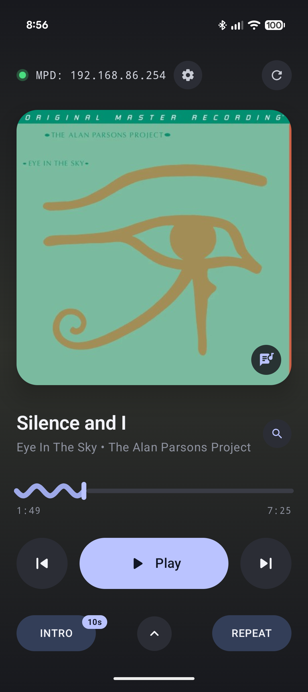
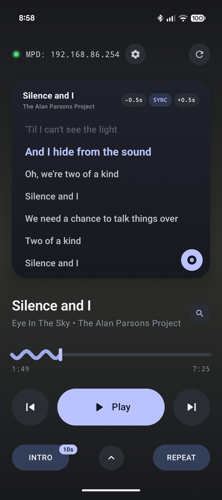
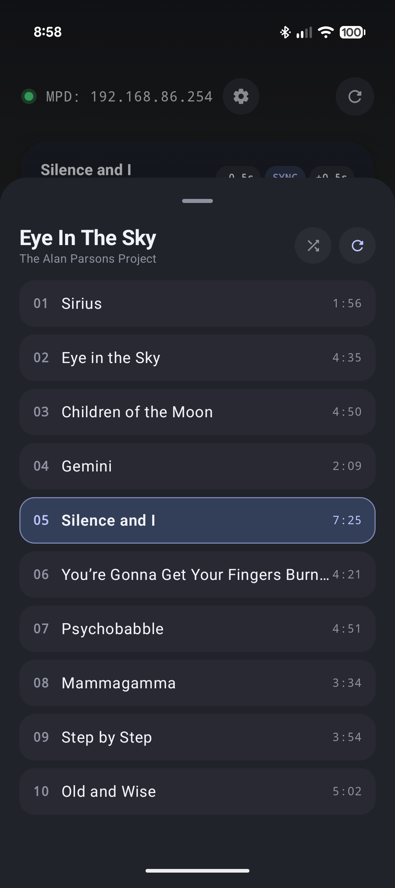

# CD/Deck 💿

**CD/Deck** is a modern Android application inspired by high-end 90s Japanese CD players, designed to control a headless physical CD player running on **Music Player Daemon (MPD)**.

Built with **Jetpack Compose** and **Material 3 Expressive**, it pairs vintage physical disc playback with modern streaming-era metadata: automatic MusicBrainz CD TOC recognition, Cover Art Archive integration, and real-time synchronized lyrics via LRCLIB.


<p align="center">
  
  
  
</p>

---

## Features

- **M3 Expressive Visuals**:
  - Center-stage 3D flippable album art card with dynamic ambient tinting extracted via AndroidX Palette.
  - Interactive scrollable synchronized lyrics face (powered by LRCLIB) with tap-to-seek and microsecond offset calibration controls (`-0.5s` / `+0.5s`).
  - High-visibility 7dp wavy progress scrubber (`~~~|---`).
  - Status LED indicating live MPD TCP socket connectivity.

- **Authentic 90s CD Deck Transport**:
  - **INTRO Scan**: Audition the first 10 seconds of each track (starting from 1:00 or 0:00) with a live countdown timer before automatically advancing to the next track.
  - **Tri-State Repeat**: Toggle cleanly between `REPEAT OFF`, `REPEAT ALL`, and `REPEAT 1` (mapped to MPD `repeat` and `single`).
  - **Shuffle Mode**: Redbook pseudo-random playback.
  - **Slide-up Tracklist**: Quick bottom sheet access to full track listing with duration timestamps and active track indicators.

- **Zero-Drive-Seeking Hardware TOC Detection**:
  - Linux kernel `ioctl` daemon (`arm64_mpd_cd_toc_helper.py`) reads the physical CD Redbook Table of Contents directly from optical drive controller RAM in ~2ms.
  - Avoids mechanical laser head seek thrashing.
  - Generates the standard 804-character MusicBrainz SHA-1 DiscID and queries MusicBrainz / Cover Art Archive for exact release matching, track titles, and high-resolution album art.
  - Manual album search dialog if an unlisted or custom CD-R is loaded.

- **Gapless HDMI / PipeWire Audio Synchronization**:
  - Configured for headless SBCs (DietPi / Raspberry Pi / Orange Pi).
  - PipeWire keep-alive ensures HDMI AVRs/TVs maintain audio clock lock between track jumps, preventing the first 1–2 seconds from being clipped.
  - App scrubber holds at `0:00` during physical optical drive seeks and aligns smoothly with audible output.

---

## Architecture & Project Structure

```
HA CD Player/
├── app/                                # Android Application
│   └── src/main/java/com/cddeck/app/
│       ├── data/
│       │   └── CdMetadataRepository.kt # MusicBrainz DiscID, Cover Art Archive & LRCLIB client
│       ├── network/
│       │   └── MpdSocketManager.kt     # Low-latency non-blocking MPD socket protocol manager
│       └── ui/
│           ├── CdDeckScreen.kt         # Jetpack Compose M3 Expressive deck UI & lyrics card
│           ├── CdDeckViewModel.kt      # Transport state, hardware sync & elapsed timers
│           ├── MainActivity.kt         # Android entry point
│           └── theme/                  # Material 3 Expressive color schemes & typography
├── arm64_mpd_cd_toc_helper.py          # Zero-dependency Linux TOC daemon for DietPi/Pi
├── tools/
│   └── mock_mpd_server.py              # Local MPD mock server for desktop UI development
├── build_apk.ps1                       # Self-contained command-line build script
└── README.md
```

---

## Headless MPD Server Setup (DietPi / Linux)

### 1. Hardware TOC Helper Daemon

Copy `arm64_mpd_cd_toc_helper.py` to `/usr/local/bin/arm64_mpd_cd_toc_helper.py`:

```bash
sudo cp arm64_mpd_cd_toc_helper.py /usr/local/bin/arm64_mpd_cd_toc_helper.py
sudo chmod +x /usr/local/bin/arm64_mpd_cd_toc_helper.py
```

Create `/etc/systemd/system/cddeck-toc.service`:

```ini
[Unit]
Description=CD/Deck MPD MusicBrainz TOC Helper Daemon
After=mpd.service
Wants=mpd.service

[Service]
Type=simple
ExecStart=/usr/bin/python3 /usr/local/bin/arm64_mpd_cd_toc_helper.py
Restart=always
RestartSec=3

[Install]
WantedBy=multi-user.target
```

Enable and start the service:

```bash
sudo systemctl daemon-reload
sudo systemctl enable --now cddeck-toc.service
```

### 2. MPD PipeWire Output Configuration

In `/etc/mpd.conf`:

```conf
audio_output {
        type            "pipewire"
        name            "PipeWire HDMI"
        mixer_type      "software"
}
```

Ensure MPD has access to PipeWire's runtime directory via `/etc/systemd/system/mpd.service.d/pipewire.conf`:

```ini
[Service]
Environment=XDG_RUNTIME_DIR=/run/user/0
Environment=PIPEWIRE_RUNTIME_DIR=/run/user/0
ExecStartPre=/bin/sh -c 'for i in $(seq 1 30); do [ -S /run/user/0/pipewire-0 ] && exit 0; sleep 1; done; exit 0'
```

### 3. WirePlumber HDMI Keep-Alive (Prevents Clipped Track Starts)

In `/root/.config/wireplumber/wireplumber.conf.d/51-hdmi-no-suspend.conf`:

```conf
monitor.alsa.rules = [
  {
    matches = [ { node.name = "~alsa_output.*hdmi*" } ]
    actions = {
      update-props = {
        session.suspend-timeout-seconds = 0
        node.pause-on-idle = false
      }
    }
  }
]
```

Restart WirePlumber:

```bash
systemctl --user restart wireplumber # or reboot
```

---

## Building the Android App

### Option A: Command-Line (No Android Studio required)

From the project root:

```powershell
.\build_apk.ps1
```

The compiled APK will be output to:
```
CDDeck-debug.apk
```

### Option B: Gradle Wrapper

```bash
./gradlew assembleDebug
```

---

## License

MIT License. See [LICENSE](LICENSE) for details.
